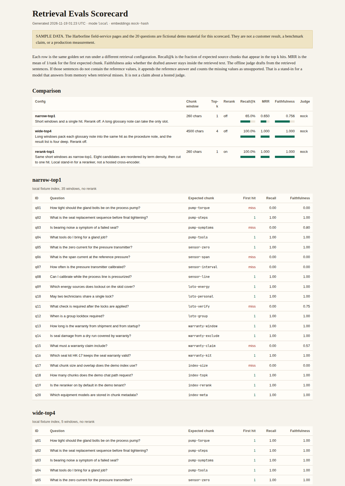

# Retrieval Evals Scorecard

A small add-on that runs one golden question set through three retrieval configurations and writes a static HTML scorecard. It does not change the RAGFlow server. The sample pages are fictional Harborline field-service notes. The numbers in the checked-in report are from that sample, not from a customer.

This is the sort of before-and-after used when showing a vector index: change the chunk window, the number of hits, or a rerank step, and see whether the expected source chunk moved. The same page is a plain check that a knowledge base returns the chunk a question was written against before anyone tunes a chat prompt.

The add-on is under the same Apache License 2.0 as RAGFlow.



## Architecture

- `corpus/` holds five sample markdown pages. Each procedure section starts with a `chunk_id:` line. Glossary sections repeat a question and then unrelated warehouse words, so a keyword-heavy shortlist can rank them above the short procedure note.
- `golden/questions.json` has 20 questions. Each names the `chunk_id` values that should be retrieved and a short reference answer.
- `configs.json` has three configs:
  - `narrow-top1`: short windows, one hit, rerank off.
  - `wide-top4`: long windows that pack a glossary note together with the procedure note, four hits, rerank off.
  - `rerank-top1`: the same short windows, eight candidates reordered by term density, then cut to one hit.
- Local mode does not start RAGFlow. It chunks the pages, ranks them with hashed token vectors plus lexical overlap, and optionally applies that density rerank. The hashed vectors are a mock embedding, not a hosted embedding model.
- Live mode calls RAGFlow `POST /api/v1/retrieval`. `page_size` is the config top-k. `rerank_id` is sent only when `RAGFLOW_RERANK_ID` is set and the config turns rerank on. `chunk_chars` is not a retrieval parameter; it describes how the local index was windowed.
- Recall@k is the fraction of expected chunk ids present in the top k hits. MRR is the mean of `1 / rank` of the first expected chunk.
- Faithfulness asks whether a drafted answer stays inside the retrieved text. With `NVIDIA_API_KEY` set and `LLM_PROVIDER=nvidia` (or `auto`), the judge and the local embeddings call NVIDIA's OpenAI-compatible API at `https://integrate.api.nvidia.com/v1`. With no key, or if a call fails, the run stays on the mock judge and the report says so.

## Run

Offline scorecard, no RAGFlow process and no API key:

```bash
docker compose -f evals/retrieval_scorecard/docker-compose.yml run --rm scorecard
```

The same run without Docker, which is what this repository's unit test executes:

```bash
python3 evals/retrieval_scorecard/scorecard.py --mode local --provider mock
python3 -m unittest discover -s evals/retrieval_scorecard/tests -v
```

From `evals/retrieval_scorecard` the unittest command is `python3 -m unittest discover -s tests -v`.

The command writes `out/scorecard.html` and `out/scorecard.json`. The repository gitignore ignores directories named `out`, so those files stay local. The sample report from the fixture run is checked in at [`docs/scorecard.html`](docs/scorecard.html), with [`docs/scorecard.json`](docs/scorecard.json) and a screenshot at [`docs/scorecard.png`](docs/scorecard.png).

To use NVIDIA for the judge and, in local mode, for embeddings:

```bash
export LLM_PROVIDER=nvidia
export NVIDIA_API_KEY=your-key
python3 evals/retrieval_scorecard/scorecard.py --mode local --provider nvidia
```

Copy `evals/retrieval_scorecard/.env.example` to `evals/retrieval_scorecard/.env` if you want the script to load those variables. Do not commit a real key.

## Live RAGFlow

1. Create a dataset and upload the five files in `corpus/`.
2. Parse them with a parser that keeps the `chunk_id:` lines in the chunk text. The scorecard treats a hit as relevant only when that marker is still in the retrieved text.
3. Export `RAGFLOW_BASE_URL` (for example `http://localhost:9380`), `RAGFLOW_API_KEY`, and `RAGFLOW_DATASET_ID`.
4. Optional: set `RAGFLOW_RERANK_ID` to a rerank model id already configured in RAGFlow. Without it, the rerank config still runs, and the report notes that `rerank_id` was not sent.
5. Run `python3 evals/retrieval_scorecard/scorecard.py --mode live`.

`chunk_chars` stays a label in live mode. Comparing real chunk sizes means parsing the same pages into separate datasets and pointing each config at its own dataset. This tool does not do that upload.

## Limits

- The sample is small and the glossary notes are written to be easy for a keyword ranker to prefer. A perfect score on `wide-top4` or `rerank-top1` is a result on this demo, not a general retrieval claim.
- The local rerank is a term-density reorder. It is not a cross-encoder.
- The mock faithfulness score drops when reference numbers and codes are missing from the retrieved text. It is not an independent model judgment.
- This VM did not start a RAGFlow stack, so the checked-in report and the unit tests use the local fixture index and the mock judge. The live client is covered by a fake HTTP response in the unit tests.
- Docker is optional. If `docker compose` cannot pull `python:3.12-alpine`, use the `python3` command above. Both run the same script.
